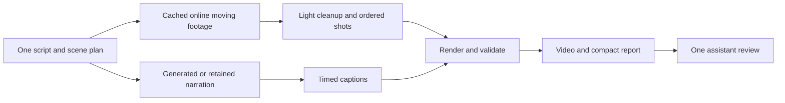

## Current repair checkpoint — 2026-11-03

The ten 61-second anime Shorts now have **sound-only DubbingAI corrections**. [Batch videos and posting packets](docs/BATCH_61S.md) · [Topic review board](docs/TOPIC_REVIEW_BOARD.md) · [Platform dashboard](docs/PLATFORM_DASHBOARD.md) · [Repair handoff and validation](docs/SOUND_REPAIR_HANDOFF.md).

All 17 actual collection recordings are cached, hashed and fully decoded in the saved bank. All ten corrections preserve Michael narration, H.264 pictures and caption timing. Older Brackeys versions remain history. No music, new TTS, footage search or story regeneration was used. The owner must choose/review topics before new full renders or posting; all proposals remain unapproved. No accounts/OAuth connections or public posts are verified; no scheduler is enabled. This checkpoint supersedes historical posting authorization and old sound-default claims below.

# Ifverse automated video workspace

**Current batch:** ten rendered **61-second anime Shorts**, with per-video posting details and persistent topic history. [Open the batch index](docs/BATCH_61S.md) · [Automation/setup](docs/AUTOMATION.md) · [Taken/reserved topics](channels/ifverse_anime-topics.json). Read the registry before choosing a premise. The owner authorized these ten posts and accepts GitHub delivery if the upload connection is unavailable; optional piano will be added by the owner in YouTube. Current connection status and selected cut versions are in CURRENT.

**Monetization goal:** produce distinct original comedy/commentary with editorial and source-use review. The saved videos are technical demonstrations, not certified monetization-ready uploads. Read [the review standard](docs/MONETIZATION_REVIEW.md) and [episode brief](prompts/editorial-brief.md). Michael and the working production tools remain the chosen setup.

**Earlier voice-selection test:** the owner chose `am_michael`. The new **60-second Goku/Avengers roast** uses fresh footage, denser v2 jokes and actual Vine Boom/faaah/Rizz recordings. [Watch the new test](https://github.com/Vpermillion/Content_Creating_WorkFlow/blob/codex/results/ifverse-michael-goku-avengers-01/artifacts/ifverse-michael-goku-avengers-01/sound-effects/video-sfx.mp4) · [CURRENT](docs/CURRENT.md) · [voice options](docs/VOICE_OPTIONS.md).

**Script tone:** follow [the owner-approved style addon](prompts/script-style.md): frequent creative roasts, playful trash talk, Gen Z/millennial slang and streetwise banter throughout the narration, with varied comparisons and callbacks. Swearing remains occasional and light. This applies to both English channels. Sound design now supports described downloadable effects on specific joke/reaction anchors; see [SOUND_EFFECTS](docs/SOUND_EFFECTS.md).

A portable, user-owned workflow for English what-if videos on **ifverse_anime** and **ifverse_hollywood**. An assistant provides one script and production plan; a finite GitHub-hosted job does the repetitive media work and returns a video plus one compact report.

**New session: read [START_HERE.md](START_HERE.md), [the current checkpoint](docs/CURRENT.md) and [AGENTS.md](AGENTS.md) first.** The current implementation is on **[codex/ifverse-workflow](https://github.com/Vpermillion/Content_Creating_WorkFlow/tree/codex/ifverse-workflow)**. The default `codex/portable-workspace` branch retains older code and routes agents to this branch. Inspect branch state before concluding a feature is missing.

[Copy-ready new-agent prompt](docs/NEW_AGENT_PROMPT.md) · [Project history and decisions](docs/PROJECT_HISTORY.md) · [Original prototype README](docs/archive/README_BEFORE_START_GUIDE.md)

## Intended operation

Footage should illustrate the actual narrated character, action, location or choice. Cuts now support explicit spoken-beat boundaries so an organization shot does not continue over a friends/protection alternative. Canon footage illustrates the invented what-if; it must not be presented as a real episode of that alternate story.

## Working components

| Component | Verified role |
| --- | --- |
| GitHub review job | Finite hosted execution with data-only requests, dependency/model/source caches, validation and versioned results. A personal PC is not required for this path. |
| Media tools | Tenor/optional YouTube lookup, bounded downloads, SHA-256/ffprobe validation and a reusable labeled clip bank. |
| FFmpeg editor | Moving clips, source trims, contain/cover framing, mild denoise/resize/sharpen, single-pass rendering, readable captions and complete audio/video/decode checks. |
| English voice | Kokoro-ONNX `am_michael`, selected and tested on CPU; older `af_heart` versions are preserved. Keep verified speech when revising pictures. |
| Caption timing | faster-whisper `tiny.en`/`base.en`, CPU/int8; recognized-word timing or exact-known-script cross-attention/DTW alignment, grouped into readable phrases. Word times remain estimates and receipts are preserved. |
| Sound design | Downloadable described/tagged public-domain sources, exact phrase-anchored cues, pitch/sub-bass treatment, speech ducking, unchanged pictures/caption timing and a saved mix receipt. |
| Continuity | Source history, safe generated examples, state/checkpoint docs and copy-ready prompts. Credentials and private production data remain separate. |

The earlier voice-selection test is **“What if Goku joined the Avengers?”**: Michael narration, 26 shots from ten new clips, 48 caption phrases and 11 actual DubbingAI-collection sound cues. Hosted run `41468364961` succeeded; all 80 local tests passed. Final decode/track/caption/source/voice and cue-energy checks passed, with every shot sample reviewed. The first generated Michael waveform and earlier Heart videos remain preserved. Full listening/editorial/source-use review remains separate; see [CURRENT](docs/CURRENT.md) for receipts and limits.

## Current workflow entry

On `codex/ifverse-workflow`, commit **exactly one** new `review-requests/*.json`. [review-video.yml](https://github.com/Vpermillion/Content_Creating_WorkFlow/blob/codex/ifverse-workflow/.github/workflows/review-video.yml) runs the request and writes its output to `codex/results/<request-id>` and the `ifverse-review-video` artifact. Documentation-only commits do not dispatch media. Request selection rejects unrelated result branches; do not resend an uncertain job before reading its saved result.

The runner accepts a validated repository script and its supplied reviewed shot plan; demonstrated inputs now include Naruto, Goku/Avengers and the ten-episode anime batch. Free-form story intake, stronger automatic semantic selection, automatic source-quality judgments and Hollywood branding are still work. Clip labels and successful file checks are not semantic approval. The original n8n/SQLite science prototype, Google connection work and wider account proposals remain in history; do not rebuild them or revive old rollout plans.

For local development, use Python 3.12+, FFmpeg/ffprobe, DejaVu Sans and `requirements-test-video.txt`. Run `python -m unittest discover -s tests -v` after behavioral changes. Read the current branch's [media tools guide](https://github.com/Vpermillion/Content_Creating_WorkFlow/blob/codex/ifverse-workflow/docs/MEDIA-TOOLS.md) and [visual matching guide](https://github.com/Vpermillion/Content_Creating_WorkFlow/blob/codex/ifverse-workflow/docs/VISUAL_MATCHING.md) for exact commands and timing contracts.

## State, access and remaining limits

The workspace must survive changing assistants. Save code, current branch, requests, output receipts and next actions; restore private state independently. Personal skills, credentials and signed-in accounts do not automatically transfer. Git proxy access does not prove GitHub API access. Preserve the managed runtime's proxy/CA and use supported network settings.

Kaggle is an optional unexecuted voice-batch template, and n8n is optional coordination. No live YouTube channel binding, public upload, continuous scheduler or production host was verified by the test. Keep publishing disabled until current authorization and provider access are verified. A successful MP4 remains a review draft until factual/plot, audiovisual, source-use and platform review. Source cleanup does not reconstruct missing detail or guarantee monetization.

Never commit passwords, OAuth client/token files, account addresses, private databases or the raw conversation PDF. The committed test media/narration is a non-secret fictional review example; real/private jobs require configured private storage. GitHub caches are not backups. Full decisions, tested outcomes and exact next actions are in the entry guides, so a new session can continue without rereading the original chat.
