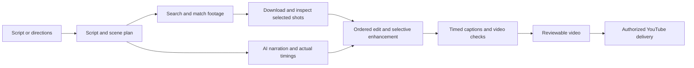

> Current entry: read `START_HERE.md` and `docs/CURRENT.md` first. Development is on `codex/ifverse-workflow`. The latest 22-shot visual-match revision has completed in run `41022041729`; older branch pointers and earlier test milestones below are historical checkpoints.

# Ifverse: current product brief

Updated from the user's clarification on 2026-10-29. This brief takes priority over the provisional science-channel examples in the original `MASTER_PROMPT.md`.

Read [the final shared-conversation agreement](CONVERSATION_DECISIONS.md) for the one-request GitHub execution model and agreed CPU captioning direction, recovered from the complete 38-page PDF. The current two-channel instruction takes priority over its older rollout plans.

**Latest tested result:** the requested 44.672-second Naruto sample now runs through the finite GitHub workflow with Kokoro-ONNX CPU narration and faster-whisper CPU/int8 phrase captions. It uses the existing selected moving-footage plan, not automatic semantic selection for an arbitrary new story. Final run `40846229359` succeeded; output is on `codex/ifverse-test-result-20261029-04`. See [TEST_VIDEO.md](TEST_VIDEO.md) for reproducible source/result checkpoints, validation and actual timings.

Current continuation is `codex/ifverse-workflow`; `START_HERE.md` and `docs/CURRENT.md` take priority over historical branch-audit pointers below. The latest request is closer shot-to-script matching plus complete replacement-agent documentation. Explicit beat intervals and verified caption/audio reuse are implemented; see `docs/VISUAL_MATCHING.md` for the reviewed 22-shot plan.

## What we are building

An automated YouTube video production workflow for two initial channels: **ifverse_anime** and **ifverse_hollywood**. The user provides a finished script or gives the assistant directions to turn into a script. The workflow should find footage that actually illustrates that script, download the selected material, assemble it in the correct narrative order, improve poor-looking footage where practical, add AI narration and synchronized captions, and produce a reviewable finished video. The intended experience is to supply the creative input and review the result, without manually assembling every shot.

The science pilots are engineering fixtures. They are not the requested channel identity, visual style, or finished Ifverse workflow.

**Core execution requirement:** one assistant planning pass → one submitted production request → autonomous GitHub processing → one completed video and compact report → one assistant review. Downloading, enhancement, captioning and rendering should not require repeated agent tool calls for each scene or stage. Keep model/footage caches and resume completed steps; inspect detailed logs only when an operation fails.

## First two channels

| Channel | Subject | Visual matching requirement |
| --- | --- | --- |
| `ifverse_anime` | Anime what-if stories, characters and alternate scenarios | Match the named series, character, action and context where footage exists; distinguish canon from an invented scenario. |
| `ifverse_hollywood` | Hollywood film what-if stories, characters and alternate scenarios | Match the named film, character, action and context where footage exists; distinguish plot facts from an invented scenario. |

These names are confirmed project channel IDs, not evidence that YouTube accounts or handles have been created or connected. **English is confirmed for scripts, narration and captions on both channels. Online video discovery and download is the intended footage route**; the user expects the workflow to find existing videos across the web rather than depend on a preassembled private clip library. Keep topic history, scripts, assets, narrator settings, outputs and publication state separate by channel. Start with YouTube; the earlier multi-platform candidates are not the first delivery target.

The specific production narrator and upload cadence remain undecided. Existing search/download providers are Tenor and optional YouTube on `codex/youtube-oauth`; they must be reused and evaluated rather than rebuilt. Do not ask the user to manually collect every clip. A vertical short is a proposed starting format inherited from the prototype, not a confirmed limit. The planning profiles in `profiles/ifverse_anime.json` and `profiles/ifverse_hollywood.json` record these distinctions. They do not connect accounts or activate a narrator.

## Required workflow

1. **Accept input.** Record the selected channel and either the user's script or creative directions. Preserve supplied wording unless changes are requested. In directions mode, the assistant or a connected writing model produces and saves the script. A chat subscription alone does not supply an unattended writing API.
2. **Plan shots.** Split the narration into beats. For each beat, save the exact spoken text, named entities, desired action or emotion, visual search queries and intended shot order. Use the generated speech to finalize durations.
3. **Find matching footage.** Search supported online sources and any authorized clip library. Rank candidates for the scene's actual meaning, character, title and action; do not accept a keyword match or random stock montage as semantic matching. Save source links and selected in/out times. An online result alone does not establish download/reuse permission: record the asset's usage basis and follow the source's supported access route.
4. **Handle unavailable scenes honestly.** A hypothetical event may have no exact existing shot. Try another relevant shot or a clearly labeled illustrative alternative. If that changes the intended meaning, flag the scene for review instead of quietly substituting unrelated footage. Never label an invented event as an actual scene from the work.
5. **Inspect and download.** Retain selected source files and their provenance, checksums, resolution, frame rate and audio properties. Detect corrupt, unusable, badly cropped or visibly degraded candidates before editing.
6. **Generate AI voiceover.** Save one stable narration result per script/voice version and real segment timings. Resume editing without regenerating it. Route failed or unavailable speech to a clear blocked state rather than silently substituting the prototype voice.
7. **Edit in narrative order.** Cut the selected source ranges to the voiceover, frame the relevant action, preserve the subject in the crop, and apply transitions and audio mixing appropriate to the scene. Save the complete edit manifest so the result is reproducible.
8. **Improve poor-looking material selectively.** Detect problems first. Prefer a better source when available; otherwise apply suitable scaling, conservative denoising, stabilization or color/exposure correction. Record the transformations and compare the result. AI upscaling is optional future work and must be evaluated for altered faces, line art, text and other artifacts. Increasing resolution alone does not restore missing detail.
9. **Caption the actual speech.** Produce editable subtitles and readable burned-in captions. The final conversation agreed to evaluate **faster-whisper on CPU with int8 precision**, with actual runner speed/memory/accuracy still untested. Preserve the known script and reconcile misheard character names. Use actual TTS timestamps or measured alignment; do not invent word timings from text length. Existing sentence boundaries can avoid transcription when sufficient; identify that limitation explicitly. Cache caption models and keep inference inside the autonomous job.
10. **Validate and deliver.** Check the complete render for matching scene order, video/audio integrity, framing, timing, caption coverage, audio levels and obvious visual defects. Save the video, thumbnail candidate, metadata draft and review report. Human content/audiovisual review remains distinct from automated file checks. Upload/schedule only through a connected YouTube route and authorized scope; prevent duplicate uploads and reconcile uncertain delivery.

## Voiceover integration decision

For the confirmed English workflow, **Kokoro-ONNX 0.6.1 with built-in `af_heart` has now generated the actual test narration on CPU**. That is a tested provisional voice, not a confirmed permanent channel voice. Speech was generated once and its verified bytes retained across retries. Faster-whisper `tiny.en` on CPU/int8 produced the test's phrase timestamps; known-script spelling corrections preserve those timestamps and retain raw recognition records. The agreed GitHub-hosted route does not require the user's PC to stay on. Keep the provider replaceable for future voice/language preferences.

The repository also has a finite Kokoro/Kaggle batch template and matching audio import/export. That notebook has not been executed or connected to Kaggle; it is separate from the successful ONNX CPU test. Kaggle remains an optional finite-batch route. No paid TTS provider is selected. The existing FFmpeg/libflite voice remains an older test fallback.

Kokoro generates speech; faster-whisper transcribes speech and estimates caption timing. Choosing faster-whisper does not supply the missing narrator. The final agreement accepts generating or reusing narration inside the integrated flow; retain verified existing audio rather than generating it again on every edit/retry.

## Branch audit: what already exists

The onboarding environment selected **`codex/portable-workspace` at `01d596f`**. That checkout predates substantial saved work. A remote branch inspection found **`codex/youtube-oauth` at `8c49432`**, built beyond `codex/operator-handoff` at `62d07b3`. The feature branch's `docs/CURRENT.md` identifies it as the media continuation branch and says not to merge/discard work implicitly. This audit fetched and read those refs without switching, merging or resetting the checkout. The feature branch's source and recorded results establish the existing implementation; this turn did not rerun its hosted job.

| Capability | Evidence/status on `codex/youtube-oauth` |
| --- | --- |
| Prepared jobs, SQLite checkpoints, recovery and worker leases | Implemented; existing test suite exercises these. |
| Local narration, original diagram assets, sentence captions, FFmpeg render and media validation | Implemented for the three provisional English science fixtures. |
| n8n-to-worker coordination | Legacy manual starter for existing `pilot-002`; it is separate from the newer GitHub media workflow. |
| GitHub Actions media workflow | `.github/workflows/media-tools.yml` accepts fixed search/collect/find/enhance/build/preview operations and runs bounded jobs on GitHub-hosted Ubuntu. A unique committed request on `codex/youtube-oauth` triggers it. Manual dispatch requires default-branch registration, which the saved checkpoint says was not performed. |
| Script/directions and shot planning | Assistant creates the story/queries; reusable tools consume structured scene plans. No unattended writing model is configured. |
| Online search, download and reusable cache | `whatif/media_tools.py` implements Tenor/YouTube search, bounded clip collection, ffprobe validation, checksum-based source caching and label lookup. Real downloads and enhancement are recorded. Search matching is lexical, not verified plot understanding. |
| Footage editing and enhancement | `whatif/media_edit.py` supports ordered clips, trimming, cover/contain framing, configured horizontal focus, retained narration, single-pass FFmpeg assembly and sentence captions. Light denoise/resize/sharpen presets exist; automatic subject detection and AI detail restoration are not established. |
| Production AI narrator and word timing | The later test branch adds working Kokoro-ONNX CPU speech and faster-whisper CPU/int8 word timestamps grouped into phrases. The older base branch has only the Kaggle template. General channel/job integration and voice selection remain work. |
| YouTube channel connection and delivery | OAuth tooling and continuity records exist on the feature branch; the saved checkpoint does not establish a live channel binding or public upload. No new authentication was attempted in this audit. |

The saved **moving-clips-only Naruto review cut** is 46.975 seconds, with **18 ordered shots from 15 downloaded MP4 sources**, retained narration and sentence captions. Its plan is `edits/alpha-anime-video.v2.json`; the report is `docs/VIDEO-ONLY-EDIT.md`. The feature branch records 47 passing local tests. This is existing work, not a new result from this documentation turn.

The saved GitHub trial [run 40491183923](https://github.com/Vpermillion/Content_Creating_WorkFlow/actions/runs/40491183923) reports successful clip collection/cache reuse/enhancement on a GitHub-hosted runner: a 36-second job and 3.845 seconds of measured media work, with zero model calls inside the job. `artifacts/hosted-media-trial-20261027.json` records it. This proves a saved on-demand tool trial, not unattended complete-video generation, continuous hosting or a new execution now.

**Correction to the first audit:** the user's report of earlier online video downloading is supported by the feature branch. Looking only at the old selected checkout led to incorrect repository-wide claims. Do not rebuild the downloader, editor or GitHub workflow from scratch. First continue from or deliberately reconcile the existing feature branch. Its private narration, database and media bank are ignored by Git and must be located/restored independently; their existence on this older machine has not been established.

Use the feature branch's `docs/CURRENT.md`, `docs/MEDIA-TOOLS.md` and `python -m whatif.media_tools` as the media entry point. The GitHub workflow already supplies an on-demand hosted runtime for these tools; n8n remains a separate coordinator option. Its hosted `build` path still requires secure private narration transfer, which the recorded preview trial did not configure.

## First usable milestone

For one new job on each channel, accept a supplied script, select traceable footage matching each narration beat, generate the chosen voiceover, render the ordered edit with captions, and save a reviewable MP4 plus the source/edit/timing manifests. Demonstrate a failed-step resume without changing retained speech. Report any unmatched beat or unavailable provider explicitly. A complete automation claim requires an actual end-to-end run; placeholder integrations and science diagrams do not satisfy this milestone.

The finite Naruto test now joins these steps in one hosted job. Next, generalize its prepared-script/selected-footage inputs into the complete parameterized production plan, add robust stage resume and channel-aware Hollywood branding, and improve story-to-query/scene matching. Benchmark fresh narration-inclusive runs separately from retained-audio runs. Do not rebuild working source adapters, expand the old science examples or register additional social platforms as a substitute for these gaps.
