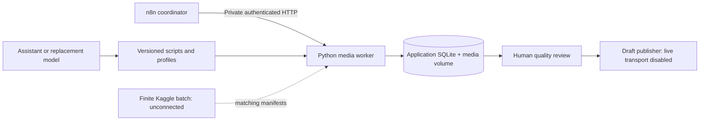

# Architecture and operation



Model-dependent work: new ideas, research synthesis, original scripts, scene judgment, editorial review. Ordinary code: leases/checkpoints, local synthetic speech, asset generation, caption assembly, FFmpeg, validation, backups and publication state transitions. Already prepared jobs can run with no model API.

Each job holds its full input configuration, SHA-256 content version and references. Stages are research-reference preparation, script, assets, narration, captions, render and quality review. `research.completed` means the reference-list file was saved; it does not mean facts were independently verified. The result explicitly records editorial approval as false. Pilot job status remains `quality_review` after media validation. Failures retain cause, attempt count, retry time and successful prior stages. Three attempts are permitted; backoff is bounded at 300 seconds. Inspect failures before issuing an intentional rebuild.

Workers use SQLite write transactions, 120-second leases and a 20-second heartbeat. A crashed worker's lease expires; a successor can resume verified artifacts. Stale workers cannot save stage checkpoints under another owner's lease. SQLite is suitable for this single-host prototype; use a transactional external database and shared/object storage before multi-host workers or high concurrency.

The worker HTTP queue has one processing thread and at most ten pending jobs. The HTTP enqueue response is not proof the render succeeded; inspect the durable status afterwards. The queue itself is in-memory; after restart the saved queued/failed jobs remain and can be submitted again. `docker compose restart worker` does not automatically run every unfinished job. Avoid unnecessary restarts during a render; restart or enqueue after lease expiry if a process was killed.

## n8n workflow operation

1. Start Compose and wait for worker `/health` and n8n `/healthz` to return success.
2. Run `python scripts/configure_n8n.py` once, and again after a deliberate workflow revision/token rotation. Reimport preserves workflow ID but should be treated as an update; do not overwrite user-edited workflows blindly.
3. Inspect the inactive workflow in n8n. The HTTP credential should be `WhatIf worker`. Change only the prepared job ID when needed.
4. For the tested CLI route while the editor is running:

   ```sh
   docker compose exec -T -e N8N_RUNNERS_BROKER_PORT=5689 n8n n8n execute --id=whatifPreparedPilot
   ```

5. Inspect the returned checkpoint and `python -m whatif status`. The starter reads status once after five seconds; add bounded status polling, failure routing and your authorized schedule before treating it as a production coordinator. No recurring schedule or notification integration is active.

The alternative broker port avoids colliding with the editor's task broker. CLI execution and import were tested on the pinned n8n image. Workflows export using `n8n export:workflow --id=whatifPreparedPilot --output=...`; exports must not include credentials. n8n and the application use distinct SQLite databases and never query one another's internal tables.

## Development and continuous hosting

Development/on-demand: use this cloud task, a local machine or a permitted Codespace. Run finite jobs, back up outputs and schedule already approved posts only through an authorized supported provider. Stopping the machine stops n8n webhooks and schedules. Do not use artificial keepalive, account rotation or trial-limit workarounds.

Continuous production: deploy the Compose services on a user-controlled Linux host with persistent storage and backups. Budget CPU, disk, bandwidth and provider usage; this task has not rented or deployed a host. Before exposing any service, add HTTPS, secure cookies, n8n owner authentication and restricted network access. Retain the worker token as a backend secret. Current loopback development ports are not a public deployment configuration. Add monitoring, bounded polling, provider reconnect handling and scheduled backups before unattended production.

GitHub Pages can show a sanitized static report only. It cannot run this backend and must never contain service credentials. GitHub Actions is used here only for software checks, not recurring social-video production. Codespaces and Actions terms/limits need current review before adopting those modes; no numeric allowance or production-hosting entitlement is assumed.

All stored event times are UTC epoch seconds. User-facing scheduling metadata uses the profile's provisional `Asia/Ulaanbaatar` timezone; future provider adapters must parse and validate timezone-aware timestamps. There are currently no scheduled times or posts.
